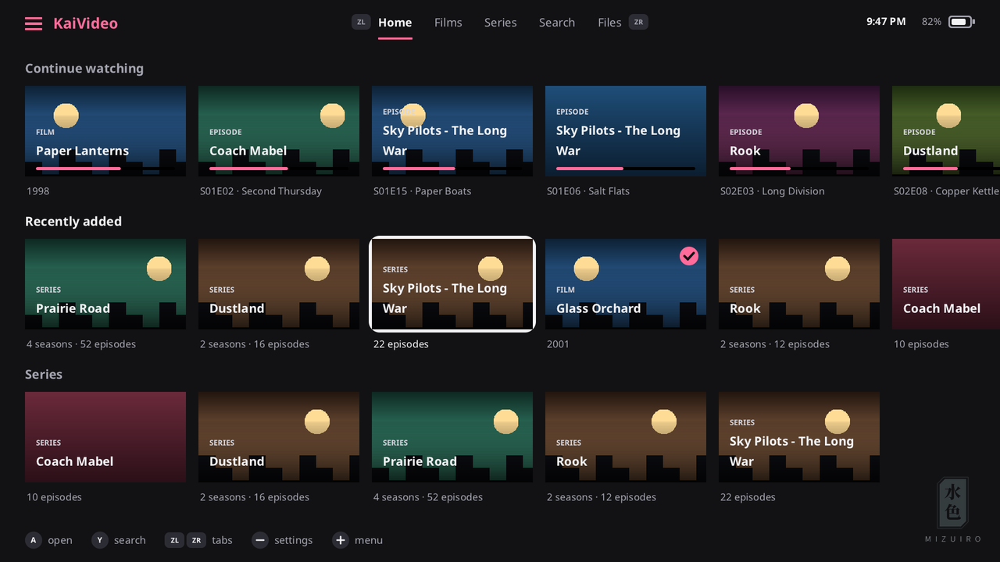
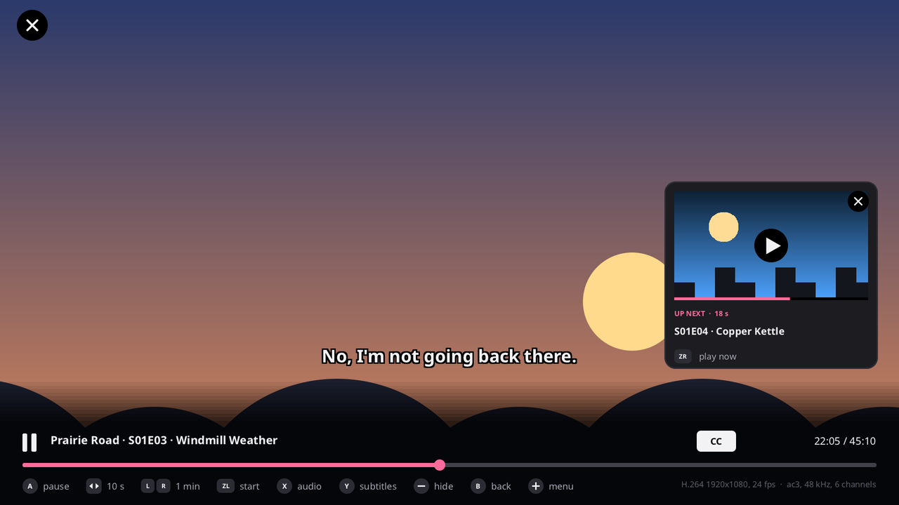
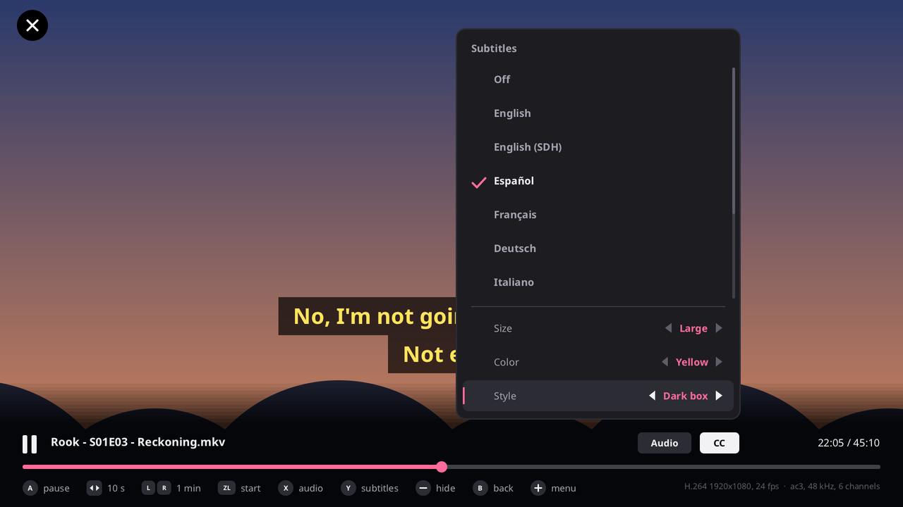
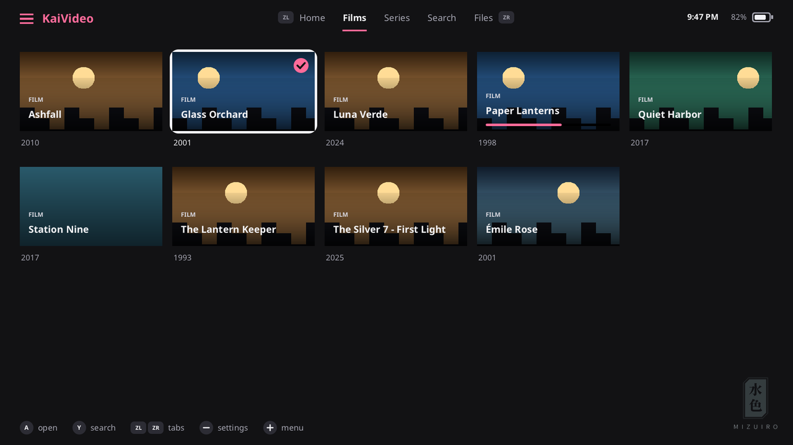
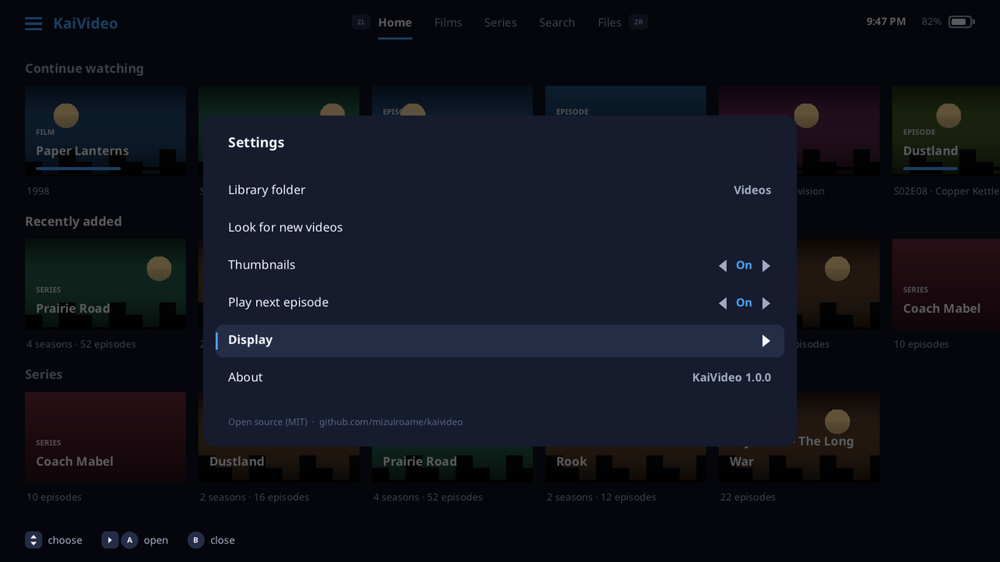
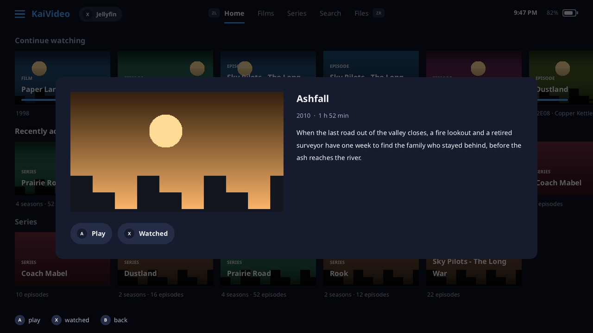

# KaiVideo

An **open-source video player** for **Switch 2** running
[kaiHEN](https://github.com/ouncebrew/kaihen), in the spirit of
[KaiPlayer](https://github.com/mizuiroame/kaiplayer) and
[KaiRadio](https://github.com/mizuiroame/kairadio). Play the videos on your
microSD card or your **[Jellyfin](https://jellyfin.org/) server**, as a library
of films and series, with the console's own hardware video decoder.



| A series | Next episode | Subtitles |
|----------|--------------|-----------|
|  |  |  |

| Films | Settings | A video on Jellyfin |
|-------|----------|---------------------|
|  |  |  |

The screenshots show made-up films and series.

> KaiVideo is an independent project. It is not affiliated with, endorsed by
> or sponsored by Nintendo. See the [Legal notice](#legal-notice).

## What it does

- A **library** of your **films and series**: choose the folder with your
  videos once, and KaiVideo finds them in it and its folders. **Home** shows
  what you were watching, what's newest, your series and your films; **Films**
  and **Series** show them all, a series opens on its seasons and episodes,
  and **Search** finds a title by name. Cards show a **picture from the
  video**, taken by the console's decoder in the background the first time.
- **Settings**: themes and accent colors, your own **background** image,
  and an About page.
- **Jellyfin**: browse your server with the same screens, sign in with Quick
  Connect or a password, and play its videos over your network. What the
  console plays as it is plays from the original file; 4K, HDR and the rest
  are converted by your server, at the quality you choose. Your libraries
  are tabs, your **favorites** have a row on Home, **Skip intro** and **Skip
  credits** come up where the server marked them, dragging the bar shows a
  **picture of that moment**, and **Live TV** has its own tab with what's on
  now and next. What you watch stays in sync with your other devices. See
  [Jellyfin](#jellyfin).
- Plays **MP4**, **M4V**, **MKV** and **WebM** files from your card.
- **Hardware video decoding** with the console's decoder: **H.264**, **VP9**,
  **AV1** and **VP8**, tried up to 1080p at 60 frames per second.
- **HEVC (H.265)**, 8-bit and 10-bit, and **10-bit H.264**, decoded on the CPU
  with FFmpeg: the console's decoder interface doesn't offer them. Measured on
  the console, a 1080p 10-bit episode decodes at several times its speed. It
  uses more battery than hardware decoding. A jump shows the nearest picture
  at once, while the exact place is decoded.
- Sound with [FFmpeg](https://ffmpeg.org/): **AAC**, **MP3**, **Opus**,
  **Vorbis**, **FLAC**, **AC-3**, **E-AC-3** (Dolby Digital Plus), **DTS**
  and **Dolby TrueHD** (surround is mixed down to stereo).
- **Sound tracks**: a film with several (languages, commentary) lets you
  pick one from a list (**X**); the picture waits a moment for the new sound.
- **Subtitles**: an `.srt` file next to the video (`Film.srt` or
  `Film.es.srt`), or the text subtitles inside the file (SubRip and ASS in
  MKV, mov_text in MP4, WebVTT), picked from a list (**Y**), or none. Their
  size, color and style (outline or a dark box) are at the end of that list.
- **ASS subtitles keep their look**, drawn by [libass](https://github.com/libass/libass):
  colors, positions, rotation, movement, fades and the fonts inside the file.
  The list offers only their size.
- **Playback list** (**↑**): the video's **chapters** (also marked on the
  progress bar), the **speed** from 0.5x to 2x with the voices' pitch kept,
  and **audio** and **subtitle delays** for a file that's out of sync.
- **Resume where you left off**: open a video you stopped halfway and it goes
  on from there (**ZL** starts it over). Videos you've started show how far
  you got.
- **Next episode**: in an episode's last 30 seconds (the credits, usually) a
  card on the right offers the next one; it plays on its own at the end, or
  at once with **ZR**. The **×** on the card lets the credits run.
- **Watched episodes** get a check mark, set when you finish one or by hand
  (**X**, or tap the circle). **Continue watching** on Home suggests each
  series' next episode.
- **Your sound track and subtitles are remembered**, for each video and for
  the rest of its series.
- A **file browser** for the whole card (the **Files** tab): folders first,
  then videos, with their sizes.
- Drawn on the GPU, sharp in handheld and docked. Every control works with the
  buttons and the touch screen.

## Install

You need a Switch 2 with **kaiHEN** running (launch a game while holding
**R** to open hbmenu), and a way to copy files to the card: OunceShell's FTP
server with an FTP client such as [FileZilla](https://filezilla-project.org/),
or [KaiDrop](https://github.com/mizuiroame/kaidrop).

1. Download `KaiVideo.nro` from the latest release on the
   **[Releases](../../releases)** page.
2. In hbmenu, open **OunceShell** and start its FTP server. It shows the
   console's address and port.
3. Connect to it from your PC, make a `kaivideo` folder inside the `switch`
   folder and copy `KaiVideo.nro` into it, so it is
   `sdmc:/switch/kaivideo/KaiVideo.nro`. (Straight in `switch` works too.)
4. Copy your videos to a folder on the card, for example `Videos`.
5. Open hbmenu and select **KaiVideo**. The first time, choose the folder with
   your videos: open it and press **X** (or tap **Use this folder**).

> **File names with accents or other non-ASCII characters** (á, ñ, ’,
> Japanese) are hidden by the console's file system, in every app. Rename
> those files, or upload them with [KaiDrop](https://github.com/mizuiroame/kaidrop),
> which gives the copies plain names.

### Settings

Press **−** (or tap **Settings**) for:

- **Library folder** and **Look for new videos**, after you copy more.
- **Play next episode**: on (the card in the last 30 seconds, and the next
  episode at the end), or off.
- **Theme** (Dark, Black, Midnight, Plum) and **Accent color**.
- **Background**: put JPEG or PNG images in a `Backgrounds` folder in your
  library folder and pick one; it's blurred (**Background blur**) and
  darkened so text stays readable.
- **Thumbnails**: pictures from the videos on their cards, or plain colors.
  They're made a few at a time while nothing plays, and kept in
  `config/thumbs`. Videos KaiVideo can't play keep their color.

### How films and series are found

KaiVideo goes by file and folder names, the way most media libraries are
kept:

- **Series**: files named with the season and episode, like
  `Rook.S01E03.Lamentia.1080p.mkv` or `Rook 1x03.mkv` (or `Rook - 03` for
  anime). A folder named after the series (`TV/Rook/`, `Rook/Season 1/`) gives
  it its name; otherwise the file's name does.
- **Films**: every other video. A `Title (Year)` folder gives the film its
  name (`Movies/Paper Lanterns (1998)/anything.mkv`); otherwise the file's name
  does, without tags like `1080p`, `BluRay` or `x264`.

> **Don't take the microSD card out while kaiHEN is running.** Removing it
> means restarting the console, and kaiHEN has to be started again after
> that.

### Jellyfin

1. In **Settings** (**−**), open **Jellyfin** and choose **Find servers on
   this network**, or type your server's address under **Server**, like
   `192.168.0.10:8096`. **Test the connection** says whether it answers, or
   which step failed: the name, the port, the time it took, the certificate.
2. Choose **Sign in with a code**: a code appears. In Jellyfin on your phone
   or computer, open your profile, choose **Quick Connect** and enter it. Or
   choose **Sign in with a password** and type your user name and password
   (the password isn't kept).
3. Your library appears. **X** on the library's screens, or the button next
   to KaiVideo's name, changes between Jellyfin and the SD card.

Your server's libraries are the tabs, by their own names (like Movies and
Shows), with Home, Search and Files. Films and episodes open a panel with
their summary: **A** plays or resumes, **Y** starts from the beginning, **X**
marks them watched and **R** adds the film, or the episode's series, to your
**Favorites** (on a series' page, **R** too). Favorites have their own row on
Home. Where you left a video, what you've watched and your favorites go to the
server and come back from it, so they match your phone and TV.

A server outside your home works over **https**. Its certificate is checked;
for a server with a certificate of its own making, turn **Certificate check**
off.

What the console can play is played from the original file: its picture,
every sound track (changed almost at once) and its subtitles, styled ones
included. Everything else, like 4K, HDR or very high bitrates, is converted by
your server to H.264 up to 1080p, with HDR turned into normal colors. Your
server needs video transcoding allowed for your account.

**Video quality**, in Settings or in the Playback list (**↑**) while a video
plays, sets the most a video may use, from **Auto** down to 420 kb/s: a
video over it is converted to fit. On a converted video, changing the
quality or the sound track opens it again at the same place, which takes a
few seconds.

Separate subtitle files on the server show in the subtitles list too. The
sign-in is kept in `config/jellyfin.txt` on the card: **Sign out** ends it on
the server.

What your server adds, when it's set up for it:

- **Skip intro, recap and credits**: where the server marked them (with a
  plugin such as [Intro Skipper](https://github.com/intro-skipper/intro-skipper),
  or chapters named so), a button comes up at the bottom right: **ZR** or a
  tap skips that part. In an episode's last seconds, **ZR** plays the next one
  instead.
- **Pictures on the bar**: with **trickplay** turned on in the server's
  libraries, dragging the progress bar shows a picture of where your finger
  is, and a far jump shows one while it loads.
- **Live TV**: with tuners or channels on the server, a **Live TV** tab shows
  its guide: a row for each channel and its programs over two hours, with a
  line at the time now. **↑** / **↓** change channel and **◀** / **▶** move
  through its programs, up to four hours ahead; the strip at the bottom says
  what the cursor is on. **A** watches the channel, converted by the server
  (tap a program to put the cursor on it, and tap it again to watch);
  **L** / **R** change channel while it plays. It starts a few seconds behind
  live, so it doesn't stop to wait for the server.

### Where KaiVideo keeps its files

Your library folder, the list of videos found in it, where you left each
video, what you've watched, the sound tracks and subtitles you chose and a
log are kept in a `config` folder next to `KaiVideo.nro`, in its own folder:
`sdmc:/switch/kaivideo/config/` (or `sdmc:/brewstore/apps/kaivideo/config/`
when brewstore installs it). Your videos aren't touched.

## Controls

**In the library:**

| Button | What it does |
|--------|--------------|
| **ZL** / **ZR** (or **L** / **R**) | The tab before or after: Home, Films, Series (or your server's libraries), Search, Files |
| **↑** **↓** **◀** **▶** | Move |
| **A** | Play the film or episode, or open the series |
| **B** | Back from a series (in Files: the folder above) |
| **Y** | Search |
| **−** | Settings |
| **+** | The menu: Look for new videos, Settings, Exit (**+** again asks to exit, and **+** once more exits) |

On **Live TV**, **↑** / **↓** change channel, **◀** / **▶** move through the
guide and **A** watches the channel. On a series, **◀** / **▶** change the season and **X** marks the episode
watched or not (or tap its circle on the right). Tap a tab, a card or a row to
open it, and drag to scroll; the **☰** before the name opens the menu. In
**Files**, **◀** / **▶** move a page and the path at the top goes to the
folder above. The line at the bottom of the screen always says which buttons
do what, as in KaiPlayer and KaiRadio.

**While a video plays:**

| Button | What it does |
|--------|--------------|
| **A** | Pause or play |
| **◀** / **▶** | Back or forward 10 seconds |
| **L** / **R** | Back or forward 1 minute |
| **ZL** | Start over |
| **↑** | The Playback list: chapters, speed, audio and subtitle delays |
| **↓** | Statistics: how it plays (from the card, the original file or converted), frames a second and how many came late, the network's speed and how much is ready ahead |
| **ZR** | **Skip intro** (or recap, or credits) when its button shows |
| **X** | The list of sound tracks |
| **Y** | The list of subtitles |
| **−** | Hide the bar (**−** again, or a tap, shows it) |
| **ZR** | In an episode's last 30 seconds: play the next one now |
| **L** / **R** | On Live TV: the channel before or after (no jumps in live video) |
| **B** | Back to the library (where you were is remembered) |
| **+** | The menu, over the video: Back to the library, Exit |

In a list of tracks, **↑** / **↓** move, **A** picks and **B** closes it.
The subtitles list stays open after you pick, for the options that apply to
them (**◀** / **▶**). In the Playback list, **A** goes to a chapter and **◀** / **▶**
change the speed and the delays (or tap the left or right half of their row).
The speed stays for the next videos until KaiVideo closes; the delays are for
the video playing.
Any button or tap shows the bar for a few seconds. With the bar showing, tap
the picture or the play button to pause or play (a paused video shows a big
play symbol), or tap or drag the progress bar to go there; **Playback**,
**Audio** or **CC** open their lists, and the **×** at the top left goes back.

## Limitations

- **Picture subtitles** (DVD and Blu-ray ones, in MKV) aren't shown; text ones
  are.
- **10-bit** VP9 and AV1, and **12-bit** HEVC, can't be played.
- **HEVC** is decoded on the CPU, because the decoder interface KaiVideo uses
  ([libounce](https://github.com/ouncebrew/libounce)) doesn't offer it. 10-bit
  video is shown in 8 bits.
- **4K HEVC** is too heavy for the CPU: measured on the console, 10-bit 4K
  decoded at 21 frames per second at 16 Mb/s and at 15 at 68 Mb/s, so frames
  are skipped to keep up with the sound.
- **HDR** on the SD card isn't converted: HDR videos play, with washed-out
  colors. From Jellyfin, the server converts them.
- **Big libraries**: tried with a few dozen videos on the console (and with
  thousands of names on a PC). With hundreds of videos, the first scan and
  the first round of pictures take longer.
- After a jump (**◀** / **▶**, **L** / **R**, the progress bar) the picture
  can stutter for a moment.
- **Jellyfin**: converted videos start, change sound track or quality, and
  jump far back, in a few seconds rather than at once, while the server
  converts from there. Their subtitles come without styles. It has been tried
  on a home network, and over https through a test proxy with a certificate
  of its own; not yet from outside a home network.
- **Live TV** has been tried with test channels a server made from video
  files, not with a TV tuner. Programs can't be recorded.

## Plans

- **HEVC in hardware**, if libounce offers it.
- **Picture subtitles** (PGS from Blu-ray, VobSub from DVD).
- Smoother jumps, and checks with big libraries on the console.

## Building

KaiVideo is built in Docker, on top of the
[ounce-devkit](https://github.com/ouncebrew/ounce-devkit) image:

```sh
docker build -t kaivideo-devkit ffmpeg   # once: the devkit plus FFmpeg (LGPL)
docker run --rm -v "$PWD:/w" -w /w kaivideo-devkit make          # KaiVideo.nro
docker build -t kaivideo-host tests      # once: what the host tests need
docker run --rm --security-opt seccomp=unconfined -v "$PWD:/w" -w /w/tests kaivideo-host make run  # host tests
docker run --rm -v "$PWD:/w" -w /w kaivideo-devkit make -C tests/preview  # screenshots
```

`ffmpeg/Dockerfile` builds FFmpeg 7.1 from its release tarball (checked by
SHA-256) with only the demuxers, parsers, bitstream filters, decoders and the
`atempo` audio filter KaiVideo needs, and fails if the build would include GPL
or non-free parts. Most video is decoded by the console, through
[libounce](https://github.com/ouncebrew/libounce)'s `VideoDecoder`; FFmpeg
decodes HEVC and 10-bit H.264.

`tools/make_icon.py` draws `icon.jpg`.

## Legal notice

- **Independent project.** KaiVideo is not affiliated with, endorsed by or
  sponsored by Nintendo Co., Ltd. or its subsidiaries.
- **Trademarks.** "Nintendo", "Nintendo Switch" and "Switch 2" are trademarks
  of their owners. They are used here only to say which hardware this program
  works with. Format names are used only to name the files KaiVideo plays.
- **No Nintendo material.** This repository and its releases contain no
  Nintendo code, SDK, firmware, cryptographic keys, games, or graphics or audio
  assets. KaiVideo is built only with open-source tools and libraries.
- **No circumvention.** KaiVideo does not circumvent any technical protection
  measure. It doesn't play DRM-protected video, and it doesn't download from
  streaming sites. It plays the files that users put on their own card.
- **FFmpeg and FriBidi.** KaiVideo uses FFmpeg, built under the LGPL 2.1 (no
  GPL or non-free parts), and FriBidi, under the same license. The script that
  builds FFmpeg is in this repository and FriBidi comes with the devkit, so
  KaiVideo can be rebuilt, changed and relinked.
- **User responsibility.** Only play videos you have the right to watch.
  Running homebrew (kaiHEN) can put your console at risk, can affect its
  warranty and can go against the manufacturer's terms of service. You do it at
  your own risk.
- **No warranty.** The software is provided "as is", without warranty of any
  kind. See [LICENSE](LICENSE).

This notice is not legal advice.

## License

KaiVideo is released under the [MIT License](LICENSE). FFmpeg is released
under the LGPL 2.1 ([third_party/FFmpeg-LGPL-2.1.txt](third_party/FFmpeg-LGPL-2.1.txt)).
The fonts are Noto Sans, under the SIL Open Font License
([third_party/NotoSans-OFL.txt](third_party/NotoSans-OFL.txt)), and images and
fonts are read, and thumbnails written, with [stb](https://github.com/nothings/stb)
(public domain). Styled subtitles use [libass](https://github.com/libass/libass)
([ISC](third_party/libass-ISC.txt)), [FreeType](https://freetype.org/)
([FTL](third_party/FreeType-FTL.txt); portions of this software are copyright
The FreeType Project, all rights reserved),
[HarfBuzz](https://github.com/harfbuzz/harfbuzz) ([MIT](third_party/HarfBuzz-MIT.txt)),
[FriBidi](https://github.com/fribidi/fribidi) ([LGPL 2.1](third_party/FriBidi-LGPL-2.1.txt)),
[libpng](third_party/libpng-LICENSE.txt), [bzip2](third_party/bzip2-LICENSE.txt)
and [zlib](third_party/zlib-LICENSE.txt). The network and Jellyfin use
[curl](https://curl.se/) ([license](third_party/curl-LICENSE.txt)) and
[Jansson](https://github.com/akheron/jansson) ([MIT](third_party/Jansson-MIT.txt)).
