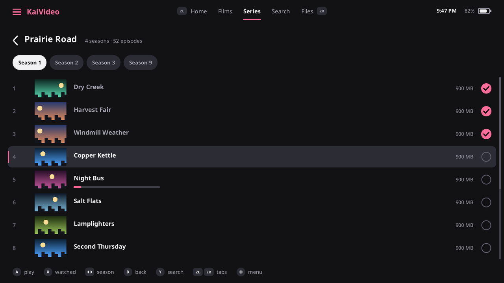
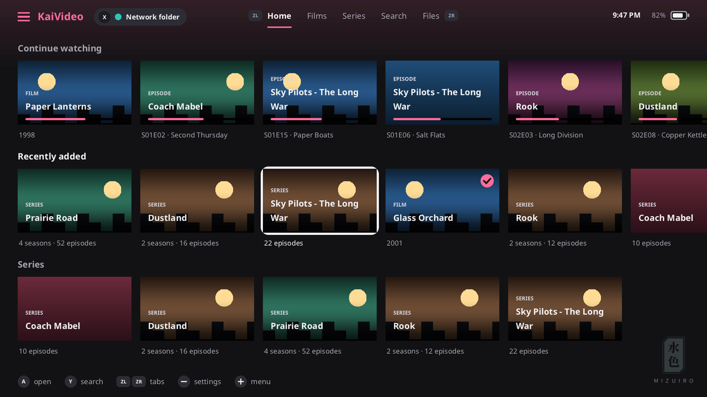
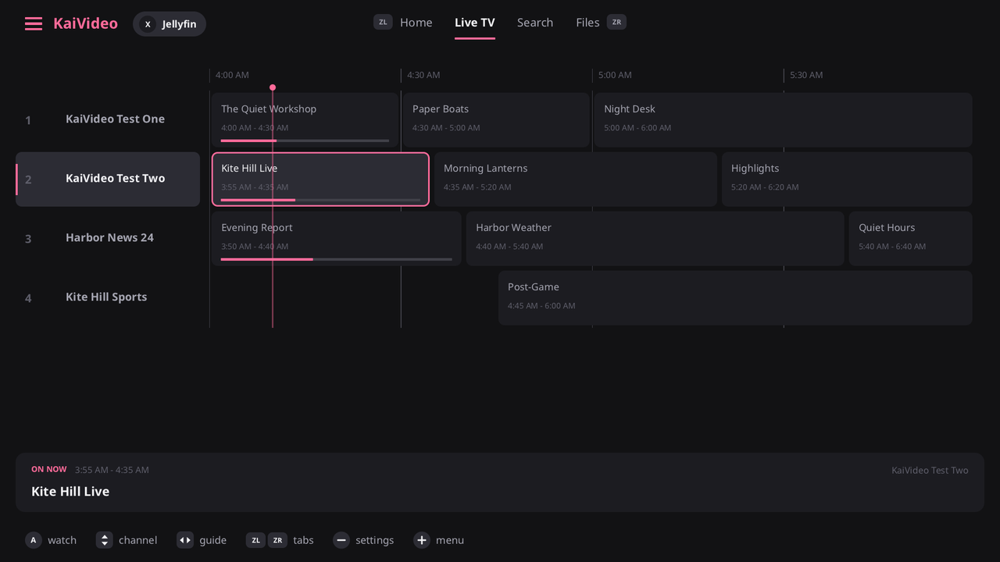
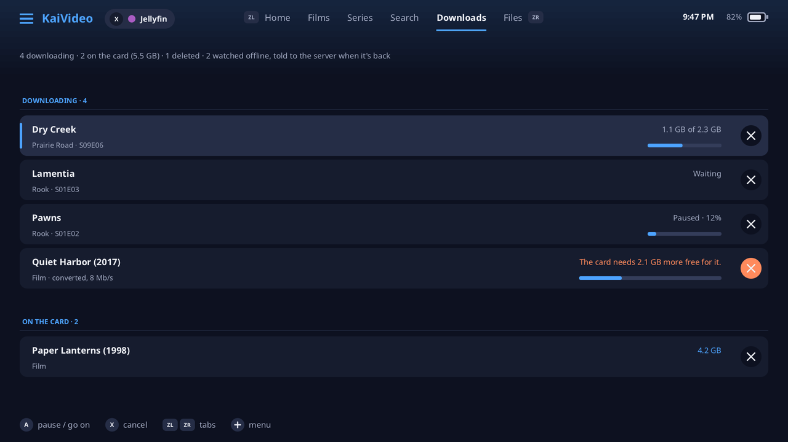
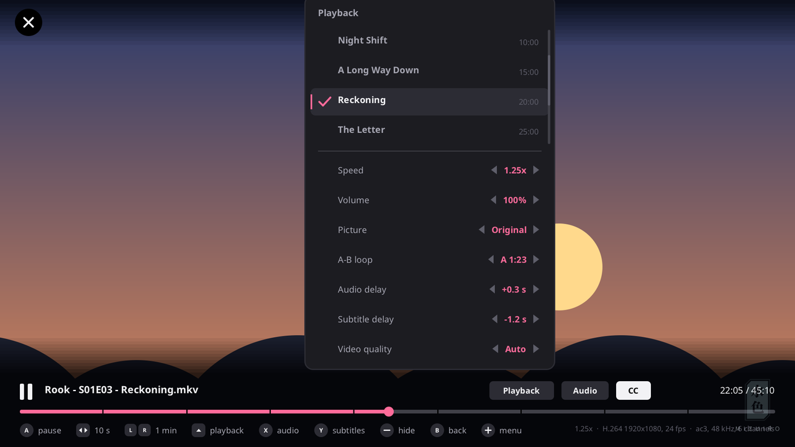
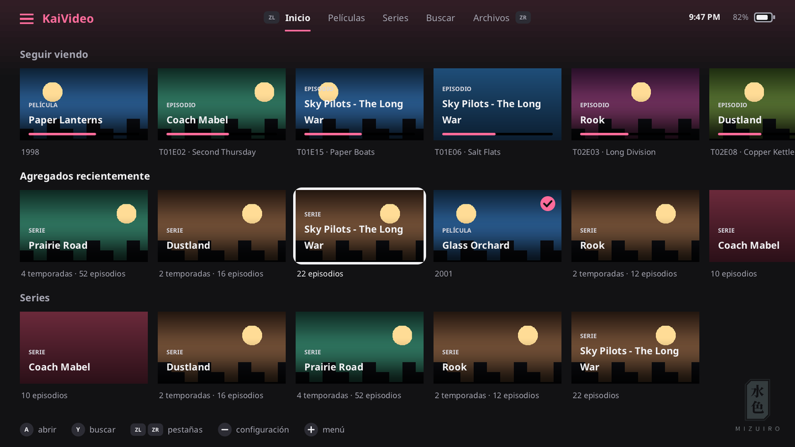

# KaiVideo

An **open-source video player** for **Switch 2** running
[kaiHEN](https://github.com/ouncebrew/kaihen). It plays the videos on your
microSD card, in a **shared folder on your network** (Windows, a NAS, Samba
or WebDAV), or on your own **[Jellyfin](https://jellyfin.org/)**,
**[Emby](https://emby.media/)** or **[Plex](https://www.plex.tv/)** server.
It shows them as a library of films and series, and decodes them with the
console's own hardware decoder. It's a sibling of
[KaiPlayer](https://github.com/mizuiroame/kaiplayer) and
[KaiRadio](https://github.com/mizuiroame/kairadio).

| A series | A video on a server | Next episode |
|----------|---------------------|--------------|
|  |  |  |

| A network folder as a library | Live TV | Downloads |
|-------------------------------|---------|-----------|
|  |  |  |

| Subtitles | The Playback list | In Spanish |
|-----------|-------------------|------------|
|  |  |  |

The screenshots show made-up films, series and channels.

> KaiVideo is an independent project. It is not affiliated with, endorsed by
> or sponsored by Nintendo. See the [legal notice](docs/legal.md).

## What it can do

- **A library of your films and series**, found by their file and folder names:
  Home shows what you were watching, what's new, your series and your films,
  each with a picture from the video. [More](docs/library.md)
- **Three places your videos can come from:**
  - **The microSD card.**
  - **A network folder:** a Windows shared folder, a NAS, Samba or WebDAV,
    browsed and played with nothing to install. [More](docs/network-folder.md)
  - **Jellyfin, Emby and Plex**, one or all three: **X** goes through them.
    It can skip intros and credits, keeps what you watch in sync, and has
    Live TV with a guide. [More](docs/media-servers.md)
- **Downloads** from your server to the card, to watch without the network,
  synced back when the network returns. [More](docs/downloads.md)
- **Hardware decoding** of H.264, VP9, AV1 (up to 4K) and VP8. HEVC and 10-bit
  video are decoded on the CPU. Plays MP4, MKV, WebM and MPEG-TS.
  [More](docs/playback.md)
- **Sound tracks and subtitles:** `.srt` files, text subtitles inside the file,
  and styled ASS subtitles that keep their look, with your choice of size,
  color and font.
- **Resume, next episode, watched marks**, and a **Playback list** with
  chapters, speed (0.5x to 2x, voices keep their pitch), volume up to 200%,
  picture size, an A-B loop and audio and subtitle delays.
- **In nine languages**: English, Spanish, French, Italian, Portuguese, German,
  Japanese, Chinese and Korean, and any other you add as a text file.
  [More](docs/languages.md)
- **Touch and buttons** for every control. Lists glide under your finger.
  [Controls](docs/controls.md)

## Install

You need a Switch 2 with **kaiHEN** running (launch a game while holding
**R** to open hbmenu), and a way to copy files to the card: OunceShell's FTP
server with an FTP client such as [FileZilla](https://filezilla-project.org/),
or [KaiDrop](https://github.com/mizuiroame/kaidrop).

1. Download `KaiVideo.nro` from the latest release on the
   **[Releases](../../releases)** page.
2. In hbmenu, open **OunceShell** and start its FTP server. It shows the
   console's address and port.
3. Connect to it from your PC, make a `kaivideo` folder inside the `switch`
   folder and copy `KaiVideo.nro` into it, so it is
   `sdmc:/switch/kaivideo/KaiVideo.nro`.
4. Copy your videos to a folder on the card, for example `Videos`. Or skip
   this step and use a network folder or a server.
5. Open hbmenu and select **KaiVideo**. The first time, choose the folder with
   your videos: open it and press **X** (or tap **Use this folder**).

> **File names with accents or other non-ASCII characters** (á, ñ, ’,
> Japanese) on the card are hidden by the console's file system, in every
> app. Rename those files, or upload them with
> [KaiDrop](https://github.com/mizuiroame/kaidrop), which gives the copies
> plain names. Network folders and servers don't have this problem.

## Documentation

- [The library](docs/library.md): how films and series are found, Settings,
  where KaiVideo keeps its files
- [Network folders](docs/network-folder.md): Windows shared folders, NAS, Samba
  and WebDAV
- [Media servers](docs/media-servers.md): Jellyfin, Emby, Plex and Live TV
- [Downloads](docs/downloads.md)
- [Playback](docs/playback.md): formats, sound tracks, subtitles, the Playback
  list
- [Controls](docs/controls.md)
- [Languages](docs/languages.md): choosing one, and translating KaiVideo
- [Limitations and plans](docs/limitations.md)
- [Building](docs/building.md)
- [Legal notice and licenses](docs/legal.md)

## License

KaiVideo is released under the [MIT License](LICENSE). It uses FFmpeg and
libsmb2 under the LGPL 2.1, and other open-source libraries and fonts. The
full list is in [docs/legal.md](docs/legal.md#licenses).
