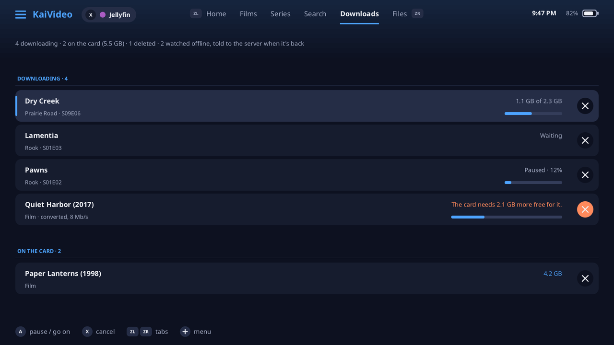

# Downloads

[Back to the README](../README.md)

A server's film, episode or whole season can be downloaded to the SD card, to
watch without the network.

## Downloading

- On a server's film or episode, **L** in its panel downloads it.
- On a series' page, **L** downloads the season shown, or the episodes of it
  not asked for yet.

They come one at a time, in the order asked for, into a `KaiVideo Downloads`
folder inside your library folder (`Films` and `Series` in it). The SD
card's library shows them with their server's names. With no library folder
chosen yet, `sdmc:/KaiVideo Downloads` becomes it. The server's subtitle file
comes with the video; subtitles inside the video are in it already.

## The Downloads tab

It appears with **ZL** / **ZR** once something was downloaded or a server is
signed in. **+** > **Downloads**, or a tap on the pill at the top, goes there
too. It shows downloads in three parts:

- **Downloading**: how far each has come. **A** pauses one or lets it go on
  (or tries a failed one again). **X** twice cancels it.
- **On the card**: **A** plays it. **X** twice deletes its file and keeps it
  in the list as a record.
- **Deleted from the card**: **A** downloads it again. **X** takes it off the
  list. **Y** (anywhere in the tab) or its **Clear** button clears all of
  them.

## When the network or the server goes away

- A download that can't reach its server waits and tries again by itself,
  more and more spaced out up to every two minutes, and at once when the
  server answers again. That covers the console being offline or the server
  being off. Only one the server refuses (gone from it, say) stops as failed.
- A download cut off by the network, the console sleeping or KaiVideo closing
  goes on from where it stopped.
- Downloads wait while a video from a server plays, so it keeps the network
  to itself.
- A download that won't fit on the card says how much room it needs.

## Marks and the pill

A film or episode downloaded has a mark beside its watched circle and on its
card:

- an SD card in a filled circle: it's on the card;
- a ring that fills: it's coming, and the ring is faint while it waits;
- two bars: it's paused;
- red: it failed.

While downloads are on their way, a pill at the top of the screen says how
many and how far they've come. A tap on it opens Downloads.

A video on the card plays from it even when you open it from the server, with
or without the network. Where you leave it and what you finish are kept on
the console. They're told to its server, for the user who downloaded it, as
soon as the server can be reached again. If you watched it somewhere else
since, what the server says stays.

## Converted downloads

What the console can't play as it is (4K HEVC, HDR and the like) is
downloaded **converted by your server**, at the **Server video quality** you
chose. On Auto that's 8 Mb/s, so a two-hour film is then about 7 GB.

- Its panel says **Download converted**, and Downloads shows how far the
  conversion has come.
- Its parts come in MPEG-TS and are rewrapped at the end into an MKV, without
  converting them again, so jumps in it land where they should.
- A conversion cut off goes on from its last whole part.
- A converted download keeps the server's sound track. Its subtitles come as
  an `.srt` file next to it (text ones only; picture subtitles aren't
  converted).
