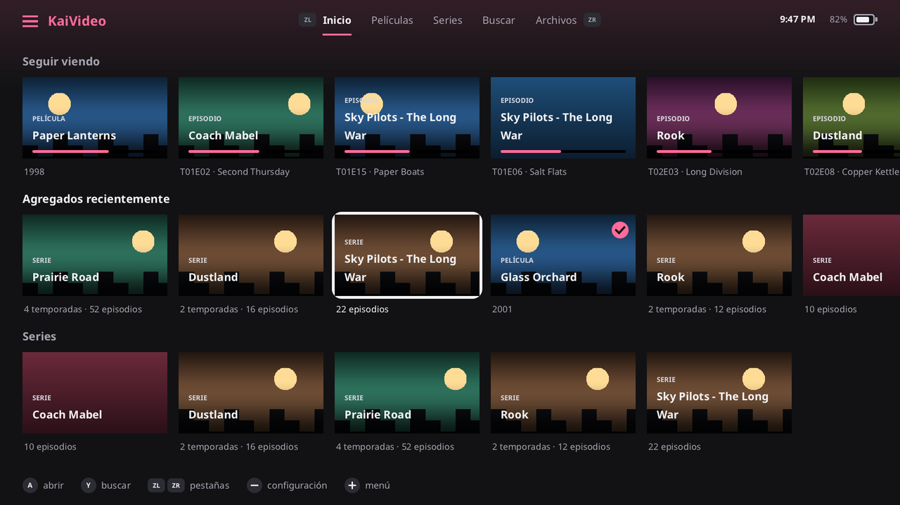

# Languages

[Back to the README](../README.md)



KaiVideo comes in **English** and **Spanish** (Latin America). Choose one in
**Settings > Display > Language**; the change shows at once.

Names that come from your files or your server (titles, libraries, track
names) are shown as they are.

## Adding a language

A language is a plain text file. Put it in the `lang` folder of KaiVideo's
`config` folder (`sdmc:/switch/kaivideo/config/lang/`), and it shows up in
**Language** the next time KaiVideo starts.

The file starts with its name, then each English text followed by its
translation, with a blank line between pairs:

```
# KaiVideo in Italian.
language = Italiano

Settings
Impostazioni

%d episodes
%d episodi
```

- Lines starting with `#` are comments.
- `\n` is a line break.
- `%d`, `%s` and the like must stay as they are, in the same order. A
  translation whose `%` parts don't match isn't used, and the English text
  shows instead, so a mistake can't break KaiVideo.
- Help lines keep their button names: `[A] open` becomes `[A] apri`.
- A text missing from the file shows in English.

To start a new language, or check one, use `tools/lang_check.py` from this
repository:

```sh
python tools/lang_check.py --template > italiano.txt   # every text, to fill in
python tools/lang_check.py italiano.txt                # what's missing, unused or wrong
```

Spanish, built into KaiVideo, is [data/lang_es.txt](../data/lang_es.txt).
Translations are welcome as pull requests.

Japanese, Chinese and Korean text is drawn with the console's own fonts.
