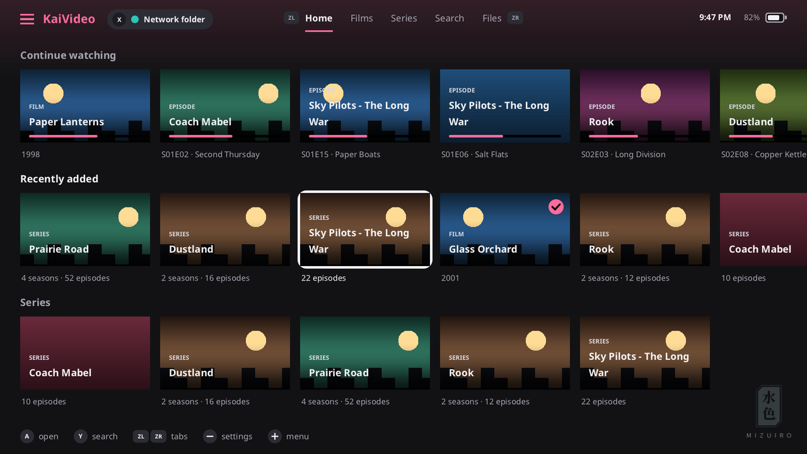
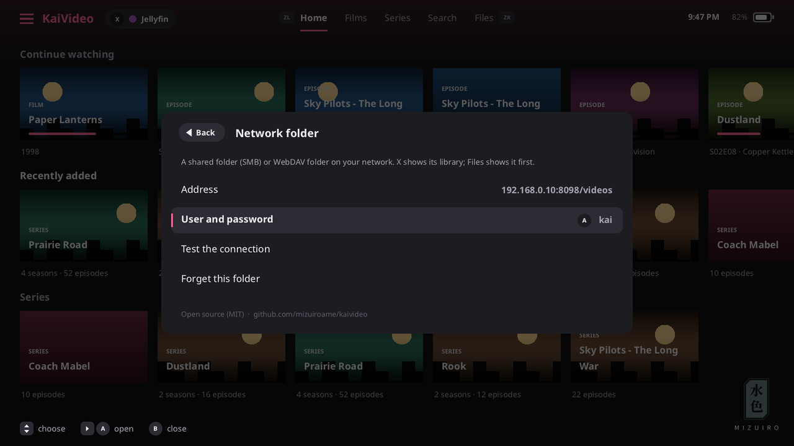

# Network folders

[Back to the README](../README.md)

KaiVideo can play from a folder on your network, with nothing to install on
it:

- a **Windows shared folder**;
- a **NAS** (Synology, QNAP and the like);
- **Samba** on Linux or macOS;
- a **WebDAV** server (Nextcloud, rclone, a NAS's WebDAV);
- an **FTP** server, plain or secure (FTPS);
- an **SFTP** server (SSH: most NAS, Linux and macOS have one);
- a **web server's folder list** (Apache, nginx, Caddy and the like with
  directory listing on).

| As a library | Its Settings page |
|--------------|-------------------|
|  |  |

## Setting it up

In **Settings > Network folder**:

1. **Address**: one of these.
   - `\\PC\Videos` or `smb://PC/Videos` for a shared folder (SMB). A folder
     inside it works too: `\\PC\Videos\Films`. Use the computer's IP address
     (`\\192.168.0.10\Videos`) if its name isn't found. For another port:
     `smb://PC:4450/Videos`.
   - `192.168.0.10:8098/videos`, or a full `http://` or `https://` address,
     for WebDAV, or a web server's folder list: KaiVideo tries WebDAV first,
     then the list.
   - `ftp://nas/Videos` for FTP. `ftpes://nas/Videos` asks the server for an
     encrypted connection and won't go on without one; `ftps://nas/Videos` is
     encrypted from the start (port 990). Another port: `ftp://nas:2121/Videos`.
   - `sftp://nas/Videos` for SFTP (port 22; another one: `sftp://nas:2222/Videos`).
2. **User and password**: the account that can read the folder. For a domain,
   type `DOMAIN\user`. With no user, the folder's guest access is used. Use
   [a user that can only read the folder](#a-user-of-its-own), not your own.
3. **Remember the password** (on): whether the password stays on the card.
   Off, nothing of it is kept, and KaiVideo asks for it the first time the folder
   is used after it starts (playing from it, opening it, updating its
   library).
4. **Allow without signing (old NAS)** (off, SMB only): shared folders are always
   signed, so nobody on the network can change what's read. Some old NAS and
   folders open to guests can't sign; KaiVideo then says so, and this lets it
   connect anyway. Turn it on only for such a folder on your home network.
5. **Certificate check** (on, `https://`, `ftpes://` and `ftps://`): the
   server's certificate must be trusted. For a NAS with a certificate of its
   own making, turn it off: only this folder's server is then taken with any
   certificate, not your media servers or anything else.
6. **Color**: the color its library wears.
7. **Test the connection**: it says how many folders and videos are at the
   top, or what went wrong.

Then:

- **X** (or the button next to KaiVideo's name) goes through the SD card, the
  network folder and each server. The network folder's library has its own
  turquoise color. It shows at once what was found the last time, and looks
  for changes in the background.
- **Files** shows the network folder first, above the card's folders, to
  browse it folder by folder.

A new address forgets the old user and password, so they're never sent to
another computer, the old folder's library, and an SFTP server's key. **Forget this folder** removes the address, user and
password.

## Sharing a folder on Windows

1. **Make your network private**: Settings > Network & internet > Ethernet
   (or Wi-Fi) > Network profile type > **Private**. On a public network,
   Windows doesn't share folders.
2. **Share the folder**: right-click it > Properties > Sharing > **Advanced
   Sharing** > check **Share this folder** and give it a name, for example
   `Media`. Under **Permissions**, give your user **Read** only: KaiVideo
   only reads.
3. On the console, type `\\<your PC's IP address>\Media` and your Windows
   user name and password. With a Microsoft account, use its e-mail address
   and password, not the PIN. If that fails, try
   `MicrosoftAccount\you@example.com`.

If **Test the connection** says nothing answered, check that **File and
Printer Sharing** is allowed in Windows Firewall for private networks.

## A user of its own

What the card keeps of the password opens the share for anyone holding the
card. So give KaiVideo a user of its own that can only read the folder,
rather than your own account (with a Microsoft account, its password opens
your e-mail too):

1. On Windows: Settings > Accounts > Other users > **Add account** > *I don't
   have this person's sign-in information* > *Add a user without a Microsoft
   account*. Give it a name such as `kai` and a password used nowhere else.
2. In the folder's **Advanced Sharing** > **Permissions**, add that user with
   **Read** only (and on the Security tab too, if the folder's own rights
   don't let it read).
3. On the console, type that user and its password, not yours.

On a NAS, make the same kind of user, with read access to the video share
only.

## Good to know

- **The password**, with **Remember the password** on, is in
  `config/network.txt`, and the card isn't encrypted. For a shared folder
  (SMB) the card keeps its hash, what Windows signs in with: the password's
  letters can't be read back from it, but the hash is as good as the password
  for that share, so use [a user of its own](#a-user-of-its-own). For WebDAV it's only encoded
  (WebDAV, FTP and SFTP send the password itself), so anyone with the card can
  read it. With **Remember the password** off, none of it is on the card. A
  file from an older KaiVideo is changed to this the first time it's read.
- **WebDAV over plain `http://` and plain `ftp://`** send the password
  without encryption. Use them only on your home network, or use `https://`,
  `ftpes://`, `ftps://` or `sftp://`.
- **SFTP checks the server's key.** The first time, KaiVideo keeps the key's
  fingerprint (`host_key=` in `config/network.txt`). If the server shows
  another key later, KaiVideo refuses to connect and sends no password: it may
  be another computer pretending to be your server. If you changed the server
  on purpose, type its address again in Settings.
- **Pictures from the folder**: a `poster.jpg`, `folder.jpg` or `cover.jpg`
  (or `.png`) in a film's own folder is its card's picture; in a series'
  folder, the series'. A folder of several films keeps its picture to itself.
  This works on the SD card too.
- **Summaries and genres**: Kodi-style `.nfo` files and `-poster`/`-fanart`
  pictures next to the videos are read while the folder is scanned. See
  [the library](library.md#summaries-genres-and-pictures-nfo-files).
- **Pictures** for the cards are made by reading each video over the network
  the first time, so they come more slowly than from the card. Once made,
  they're kept.
- Opening a folder in Files waits for the server's answer. That's usually a
  moment, but it can take several seconds when the server doesn't answer.
- `.srt` files next to a video load as on the SD card: `name.srt`, or
  `name.es.srt` and the like.
- A web server's folder list has no sizes or dates, so "Recently added"
  can't order its videos.
- Tried with a Windows 11 shared folder, a Samba server, an rclone WebDAV
  server, pure-ftpd, vsftpd, an OpenSSH SFTP server and nginx's folder list,
  all on a home network.
