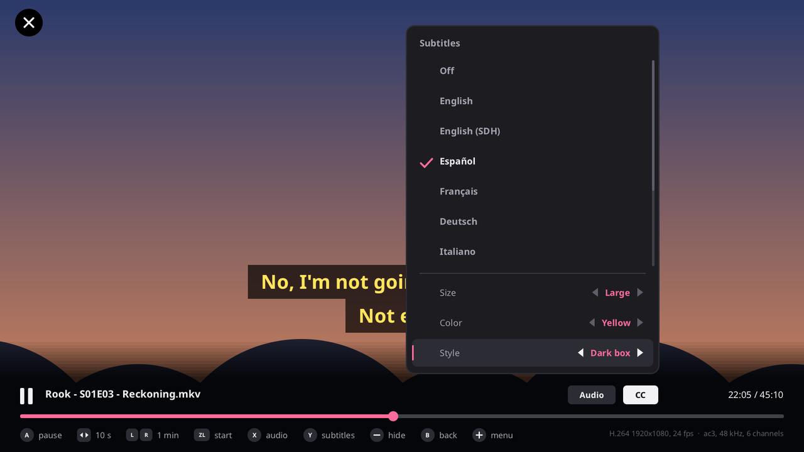
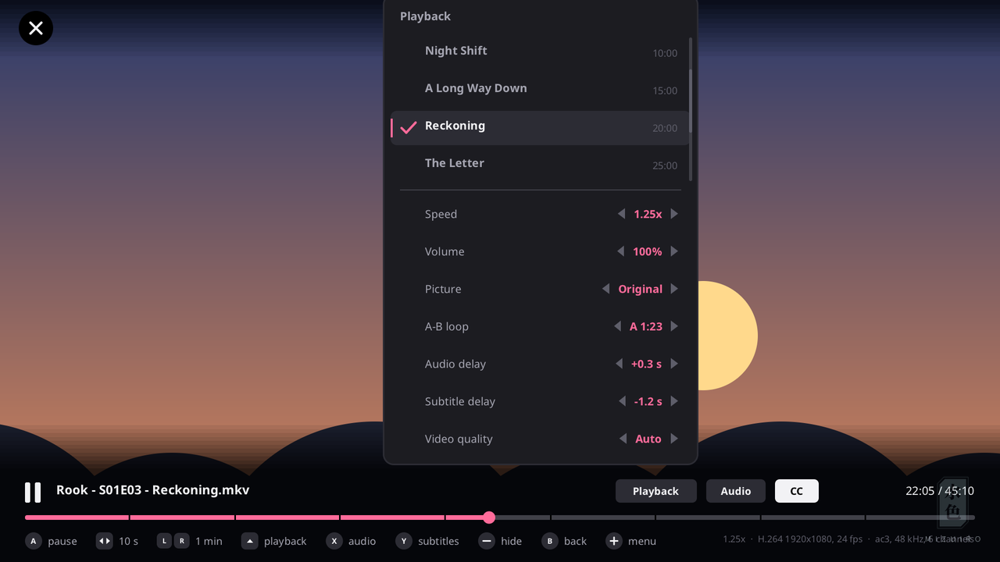

# Playback

[Back to the README](../README.md)

## Formats

- **Files**: MP4, M4V, MKV, WebM and MPEG-TS.
- **Hardware video decoding** with the console's decoder: **H.264**, **VP9**,
  **AV1** and **VP8**, tried up to 1080p at 60 frames per second, and **AV1
  in 4K**.
- **HEVC (H.265)**, 8-bit and 10-bit, **10-bit H.264** and **10-bit VP9** are
  decoded on the CPU with FFmpeg, because the console's decoder interface
  doesn't offer them. Measured on the console, a 1080p 10-bit episode decodes
  at several times its speed. It uses more battery than hardware decoding. A
  jump shows the nearest picture at once, while the exact place is decoded.
- **4K from the card**: AV1 is decoded in hardware. H.264 and VP9 are decoded
  on the CPU (the console's decoder doesn't take them over 1080p). Measured on
  the console, 4K at 30 frames per second plays smoothly in all three; H.264
  at 60 skips about one frame in ten. The picture is shown at the screen's
  1080p.
- **Sound**, with [FFmpeg](https://ffmpeg.org/): **AAC**, **MP3**, **Opus**,
  **Vorbis**, **FLAC**, **AC-3**, **E-AC-3** (Dolby Digital Plus), **DTS** and
  **Dolby TrueHD**. Surround is mixed down to stereo.

Drawn on the GPU, sharp in handheld and docked.

## Sound tracks

A film with several sound tracks (languages, commentary) lets you pick one
from a list (**X**). The picture waits a moment for the new sound.

## Subtitles

- **Where they come from**:
  - an `.srt` file next to the video on the card (`Film.srt` or
    `Film.es.srt`);
  - the text subtitles inside the file: SubRip and ASS in MKV, mov_text in
    MP4, WebVTT.
- **Choosing**: pick one from a list (**Y**), or none.
- **Their look**: size, color, style (outline or a dark box) and **font** are
  at the end of that list. The fonts are:
  - KaiVideo's own;
  - five it brings: Atkinson Hyperlegible, Fira Sans, Lato, PT Serif and
    Comic Neue;
  - your own `.ttf` or `.otf` files, put in the `fonts` folder of KaiVideo's
    `config` folder. Characters a font lacks come from the built-in ones.
- **ASS subtitles keep their look**, drawn by
  [libass](https://github.com/libass/libass): colors, positions, rotation,
  movement, fades and the fonts inside the file. The list offers only their
  size.

**Your sound track and subtitles are remembered**, for each video and for the
rest of its series.

## The Playback list

**↑** while a video plays opens it:

- the video's **chapters**, also marked on the progress bar;
- the **speed**, from 0.5x to 2x, with the voices' pitch kept;
- the **volume**, up to 200%, with a limiter so loud parts don't distort;
- the **picture**: Original, Fill, Stretch, 4:3 or 16:9;
- an **A-B loop**;
- **audio** and **subtitle delays**, for a file that's out of sync;
- the **Server video quality**, for a server's video.

The speed, volume and picture stay for the next videos until KaiVideo closes.
The delays and the loop are for the video playing.

## Resume, next episode and watched marks

- **Resume where you left off**: open a video you stopped halfway and it goes
  on from there (**ZL** starts it over). It's remembered after the first 30
  seconds. Videos you've started show how far you got.
- **Next episode**: in an episode's last 30 seconds (the credits, usually), a
  card on the right offers the next one. It plays on its own at the end, or
  at once with **ZR**. The **×** on the card lets the credits run.
  **Play next episode** in Settings turns it off.
- **Watched episodes** get a check mark, set when you finish one or by hand
  (**X**, or tap the circle). **Continue watching** on Home suggests each
  series' next episode.
- **Statistics** (**↓**) say how it plays (from the card, a network folder,
  the original file or converted), the frames a second and how many came
  late, the network's speed and how much is ready ahead.
